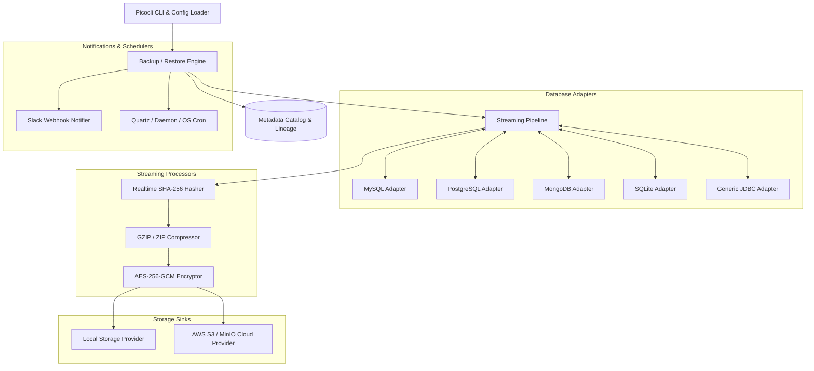

# erpo

[](https://www.oracle.com/java/)
[](LICENSE)
[]()
[]()

> **erpo** is an enterprise-grade, high-performance command-line utility (CLI) for backing up and restoring **any** database management system (MySQL, PostgreSQL, MongoDB, SQLite, and Generic JDBC). Engineered with a reactive streaming pipeline, DataShield enforces constant $O(1)$ memory consumption regardless of database size, real-time SHA-256 cryptographic checksumming, AES-256-GCM authenticated encryption at rest, pluggable local and cloud storage (AWS S3, MinIO, Ceph, R2), selective table/collection restoration, automated scheduling, and rich Slack disaster-recovery alerting.

---

## Architecture & System Design

DataShield is designed using **Hexagonal Clean Architecture** and the **Strategy Pattern (SPI)** to decouple storage, database connectivity, compression, and encryption into pluggable, independently testable modules:



### Key Architectural Strengths

1. **Dual-Mode Adapter Strategy**:
   - **Native Process Streaming**: Automatically detects and leverages database native binaries (`mysqldump`, `pg_dump`, `mongodump`, `sqlite3`) when present on the system for native transaction isolation and replication coordinates.
   - **Pure Java Driver Fallback**: If external binaries are missing (common in minimal containers and cloud runtimes), DataShield seamlessly transitions to **Pure-Java JDBC / Driver streaming mode**, ensuring 100% portability without external dependencies.
2. **True Stream Processing ($O(1)$ RAM)**:
   - Data flows through a buffered ring pipeline (`PipedOutputStream` $\to$ `HashingOutputStream` $\to$ `GZIPOutputStream` $\to$ `CipherOutputStream` $\to$ `StorageProvider`). Data is never buffered wholly in RAM or spooled unnecessarily to disk.
3. **Authenticated Encryption at Rest (AEAD)**:
   - Uses **AES-256-GCM** with PBKDF2WithHmacSHA256 (65,536 iterations), unique 16-byte random salt, and 12-byte random IV. Any byte corruption or password mismatch causes immediate cryptographic authentication failure.
4. **Metadata Catalog & Lineage Tracking**:
   - Maintains an enterprise JSON manifest catalog tracking execution times, raw bytes, compressed bytes, compression ratio, SHA-256 digest, and parent backup pointers (`FULL` $\to$ `DIFFERENTIAL` $\to$ `INCREMENTAL`).
5. **Cross-Platform Compatibility**:
   - First-class support for **Windows**, **Linux**, and **macOS**.

---

## Feature Matrix

| Feature | Details |
|---|---|
| **Supported DBMS** | MySQL, PostgreSQL, MongoDB, SQLite, and Generic JDBC (Oracle, SQL Server, MariaDB, CockroachDB) |
| **Backup Types** | `FULL`, `DIFFERENTIAL`, `INCREMENTAL` with log coordinate tracking (Binlog, WAL LSN, ClusterTime) |
| **Compression** | `GZIP`, `ZIP`, `NONE` |
| **Encryption** | `AES_256_GCM` (authenticated streaming encryption) |
| **Storage Targets** | Local Filesystem, AWS S3, MinIO, Cloudflare R2, Ceph (`s3://bucket/prefix`) |
| **Selective Filtering**| `--tables` and `--exclude-tables` supporting exact names and wildcards (`users_*`, `temp_*`) |
| **Pre-flight Checks** | `test-connection` and `--dry-run` to validate reachability and permissions before running |
| **Integrity Checks** | `verify` subcommand with real-time SHA-256 comparison against manifest |
| **Retention Policy** | Automated pruning of local backups older than `--retention-days <N>` |
| **Notifications** | Rich formatted Slack webhook messages with status, duration, throughput, and size |
| **Automation** | Long-running daemon scheduler, Linux crontab exporter, and Windows Task Scheduler script generator |

---

## Quickstart & Installation

### Prerequisites
- **Java 21 LTS** or higher
- **Maven 3.8+** (for building)

### Build Executable Fat JAR
```bash
mvn clean package -DskipTests
```
The self-contained executable JAR will be located at: `target/datashield.jar`

---

## CLI Usage Reference

### 1. Pre-flight Connection Testing
Test database credentials and target storage reachability before running any backup or restore:
```bash
# Test MySQL connection and local destination
java -jar target/datashield.jar test-connection -d MYSQL -H localhost -P 3306 -u root -p secret -D production --storage ./backups

# Test PostgreSQL connection
java -jar target/datashield.jar test-connection -d POSTGRESQL -H 10.0.0.5 -u postgres -p secret -D analytics_db

# Test SQLite file
java -jar target/datashield.jar test-connection -d SQLITE -D /var/data/app.db
```

### 2. Executing Backups (`backup`)
```bash
# Full compressed & encrypted backup to local directory
java -jar target/datashield.jar backup \
  -d MYSQL \
  -H 127.0.0.1 \
  -u backup_user \
  -p MyPassword123 \
  -D ecommerce \
  -t FULL \
  -c GZIP \
  -e "MasterRecoveryKey2026!" \
  -o ./backups \
  --retention-days 30

# Backup directly to AWS S3 / MinIO cloud storage
java -jar target/datashield.jar backup \
  -d POSTGRESQL \
  -H db.internal.cloud \
  -u pgadmin \
  -p MySecret \
  -D finance \
  -o s3://enterprise-db-backups/finance/ \
  --slack-webhook https://example.com/slack-webhook-endpoint

# Selective table backup (including 'customers' and 'orders', excluding 'orders_temp')
java -jar target/datashield.jar backup \
  -d MYSQL \
  -D ecommerce \
  --tables "customers,orders,order_items" \
  --exclude-tables "orders_temp" \
  -o ./backups
```

### 3. Listing Backups (`list`)
Inspect the global backup catalog or query a specific storage directory / S3 bucket:
```bash
# List all backups in local storage
java -jar target/datashield.jar list --storage ./backups
```
*Sample Output:*
```text
=========================================================================================================================
BACKUP ID  | DATABASE     | DBMS       | TYPE         | START TIME (UTC)     | RAW SIZE   | ARCHIVE    | RATIO  | PARENT ID 
=========================================================================================================================
2a84718f   | ecommerce    | MYSQL      | FULL         | 2026-11-15 05:52:07  | 12.00 KB   | 503.00 B   | 24.43 x | -         
9feb475f   | finance      | POSTGRESQL | DIFFERENTIAL | 2026-11-15 06:15:20  | 4.25 MB    | 812.00 KB  |  5.35 x | 2a84718f  
=========================================================================================================================
Total Backups: 2
```

### 4. Cryptographic Integrity Verification (`verify`)
Verifies that the archive has not suffered bit rot, disk failure, or malicious tampering:
```bash
java -jar target/datashield.jar verify \
  -s ./backups/ecommerce_full_2026-11-15_2a84718f.gz.enc \
  -p "MasterRecoveryKey2026!"
```
*Output:*
```text
=================================================
       DataShield Archive Integrity Verifier     
=================================================
Reading archive: ecommerce_full_2026-11-15_2a84718f.gz.enc
Computed SHA-256 Digest : 804a5da6e7fe39bdc9c70fd9954140bb3313b8f924e2822a0b09c5a2c5bbed8a
Decompressed Raw Bytes  : 12.00 KB

>>> ARCHIVE READ CHECK: PASSED! Archive uncompresses cleanly without corruption.
```

### 5. Restoring a Database (`restore`)
Recover a database from a backup archive (local path, S3 URI, or catalog backup ID):
```bash
# Full restore with on-the-fly AES decryption and decompress
java -jar target/datashield.jar restore \
  -s ./backups/ecommerce_full_2026-11-15_2a84718f.gz.enc \
  -d MYSQL \
  -H 127.0.0.1 \
  -u root \
  -p MyPassword123 \
  -D ecommerce_restored \
  -e "MasterRecoveryKey2026!"

# Selective table restore
java -jar target/datashield.jar restore \
  -s ./backups/ecommerce_full_2026-11-15_2a84718f.gz.enc \
  -d MYSQL \
  -D ecommerce \
  --tables "customers" \
  -e "MasterRecoveryKey2026!"

# Dry-run validation (verifies credentials and archive integrity without modifying DB)
java -jar target/datashield.jar restore \
  -s ./backups/ecommerce_full_2026-11-15_2a84718f.gz.enc \
  -d MYSQL \
  -D ecommerce \
  --dry-run
```

### 6. Scheduling & Automation (`schedule`)
```bash
# Run in continuous background daemon mode (e.g. backup every 6 hours = 360 min)
java -jar target/datashield.jar schedule --daemon --interval-minutes 360 --config datashield.yaml

# Generate Linux crontab definition
java -jar target/datashield.jar schedule --export-cron "0 2 * * *" --config datashield.yaml

# Generate Windows Task Scheduler PowerShell script
java -jar target/datashield.jar schedule --export-windows --config datashield.yaml
```

---

## Configuration File Template (`datashield.yaml`)

To avoid passing sensitive credentials on the command line, DataShield supports YAML and JSON configuration files:

```yaml
database_type: MYSQL
host: "127.0.0.1"
port: 3306
database: "production_db"
username: "backup_admin"
password: "EnterpriseMasterPassword"

backup_type: FULL
compression: GZIP
encryption_password: "MasterRecoveryKey2026!"
destination: "s3://company-db-backups/prod/"
retention_days: 30

include_tables:
  - "users"
  - "orders"
  - "transactions"

exclude_tables:
  - "cache_*"
  - "temp_logs"

slack_webhook: "https://example.com/slack-webhook-endpoint"
```
Execute using the config:
```bash
java -jar target/datashield.jar backup --config datashield.yaml
```

---

## Running Test Suite

DataShield includes a comprehensive suite of unit and integration tests covering AES-256-GCM encryption, AEAD tag corruption validation, GZIP compression, TableFilter patterns, metadata catalog lineage, and real end-to-end SQLite backup/restore execution:

```bash
mvn test
```
*Test Summary:*
```text
[INFO] Results:
[INFO] Tests run: 14, Failures: 0, Errors: 0, Skipped: 0
[INFO] BUILD SUCCESS
```

---

## License
Apache License 2.0. Built for enterprise high-availability and disaster recovery.

